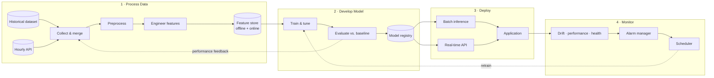

# SkyCast

[](https://www.python.org/)
[](https://docs.astral.sh/uv/)
[](https://docs.astral.sh/ruff/)
[](LICENSE)

**SkyCast** is an end-to-end MLOps weather forecasting platform. It covers the full machine
learning lifecycle (data collection, feature engineering, training, deployment, and monitoring
with automated feedback loops) using local, open-source tools.

The architecture follows the
[AWS Well-Architected Machine Learning Lens](https://docs.aws.amazon.com/wellarchitected/latest/machine-learning-lens/machine-learning-lens.html)
lifecycle, implemented without AWS.

> **Status:** 🚧 Early development (Phase 0, project setup). See the [roadmap](#roadmap).

## Highlights

- **Multi-city by design.** Cities (name, coordinates, timezone) are configuration, not code.
  The first target city is Toronto.
- **Two data sources merged.** 10+ years of historical observations plus an hourly, rate-limited
  recent-observations API, with overlap handling and timestamp deduplication.
- **Leakage-safe modelling.** Time-based splits only, and every model must beat a baseline
  (persistence / seasonal average).
- **Reproducible lineage.** Data + code + parameters → model → prediction is fully traceable.
- **Closed loop.** Drift and performance monitoring trigger retraining automatically.

## Architecture



| Phase | What happens |
|---|---|
| **1. Process Data** | Collect historical and recent observations, preprocess, engineer features (lags, rolling stats, cyclical time encoding, dew point, wind u/v, pressure change), and store them in an offline + online feature store. |
| **2. Develop Model** | Train and tune with time-series cross-validation, evaluate against baselines, and register model artifacts with full lineage. |
| **3. Deploy** | Serve the registered model through scheduled batch inference and a real-time API, consumed by a web app. |
| **4. Monitor** | Track data drift, forecast accuracy against observed weather, and system health. Alerts and the scheduler close the retraining loop. |

## Tech stack

| Component | Tool |
|---|---|
| Environment & packaging | [uv](https://docs.astral.sh/uv/), `pyproject.toml`, `src/` layout |
| Data processing | pandas / Polars |
| Feature store | Feast, or Parquet (offline) + Redis/SQLite (online) |
| Training & tuning | scikit-learn, XGBoost / LightGBM, Optuna |
| Registry & lineage | MLflow, DVC, Git |
| Serving | FastAPI, Docker |
| Application | Streamlit |
| Monitoring | Evidently AI (optional: Prometheus / Grafana) |
| Scheduling | Prefect |
| Code quality | Ruff, pytest, pre-commit, GitHub Actions |

> Tools beyond Phase 0 are planned and may change as Python 3.14 compatibility is verified.

## Quickstart

**Prerequisites:** [uv](https://docs.astral.sh/uv/getting-started/installation/) and Git.
uv installs the pinned Python version (3.14) automatically.

```bash
git clone https://github.com/ehsanap7/skycast.git
cd skycast

uv sync                       # create .venv and install the project + dev tools
uv run pre-commit install     # enable the git pre-commit hooks (once per clone)

uv run skycast                # → Hello from SkyCast v0.1.0!
```

### Build the local datasets

Place the configured raw CSV in `data/bronze/city=<slug>/`, then run:

```bash
uv run skycast data build
```

This validates bronze and writes clean hourly Parquet to `data/silver/` and model-ready Parquet to
`data/gold/`. Dataset files stay local and are ignored by git. The command is safe to rerun.

### Update the data

Run one update now:

```bash
uv run skycast data update --source recent
uv run skycast data update --source archive
```

Or run both on their configured schedules with Prefect:

```bash
uv sync --extra orchestration
uv run prefect config set PREFECT_API_URL=http://127.0.0.1:4200/api  # once

uv run prefect server start      # terminal 1, UI at http://127.0.0.1:4200
uv run skycast data schedule     # terminal 2
```

Scheduled runs execute one at a time. Do not run a manual update while the scheduler is active.

### Development commands

```bash
uv run pytest                       # run the test suite
uv run ruff check .                 # lint
uv run ruff format .                # format
uv run pre-commit run --all-files   # run every pre-commit hook
```

## Project structure

```
skycast/
├── src/skycast/            # application package
│   ├── __init__.py         # package version
│   └── cli.py              # `skycast` command-line entry point
├── tests/                  # pytest test suite
├── .pre-commit-config.yaml # git hooks (ruff, file hygiene, secret detection)
├── .python-version         # pinned Python version for uv
├── pyproject.toml          # metadata, dependencies, ruff & pytest config
└── uv.lock                 # locked dependency versions
```

## Roadmap

- [ ] **Phase 0: Setup.** Project skeleton, tooling, CI, contributor guide
- [ ] **Phase 1: Process Data.** Collection (historical + hourly API), preprocessing, feature engineering, feature store
- [ ] **Phase 2: Develop Model.** Baselines, training, tuning, evaluation, MLflow tracking and registry
- [ ] **Phase 3: Deploy.** Batch + real-time inference (FastAPI), Streamlit app, Docker
- [ ] **Phase 4: Monitor.** Drift and performance monitoring, alerting, scheduling, retraining loop
- [ ] *Optional:* cloud deployment

## Development workflow

All work follows **Issue → Branch → Commits → Pull Request → Review → Squash-merge**:

- Each task starts as a GitHub issue with a checklist and acceptance criteria.
- Branches are named `<type>/<issue#>-<short-name>` (e.g. `chore/1-project-setup`).
- Commits follow [Conventional Commits](https://www.conventionalcommits.org/)
  (`feat:`, `fix:`, `chore:`, `docs:`, `refactor:`, `test:`, `ci:`).
- `main` is protected: changes land only through reviewed pull requests.
- Secrets live in a git-ignored `.env` file; never commit credentials.

## Data attribution

Weather data is provided by [Open-Meteo](https://open-meteo.com/) under the
[CC BY 4.0 licence](https://creativecommons.org/licenses/by/4.0/). Historical data comes from the
ERA5 reanalysis. Generated using Copernicus Climate Change Service information 2022.

SkyCast modifies this data by validating and cleaning values, aggregating hours into local days,
and deriving forecasting features and targets. The MIT License below covers this project's code,
not the weather data.

- Zippenfenig, P. (2023). *Open-Meteo.com Weather API*. Zenodo.
  <https://doi.org/10.5281/ZENODO.7970649>
- Hersbach, H. et al. (2023). *ERA5 hourly data on single levels from 1940 to present*. Copernicus
  Climate Change Service (C3S) Climate Data Store. <https://doi.org/10.24381/cds.adbb2d47>

## License

Released under the [MIT License](LICENSE).
